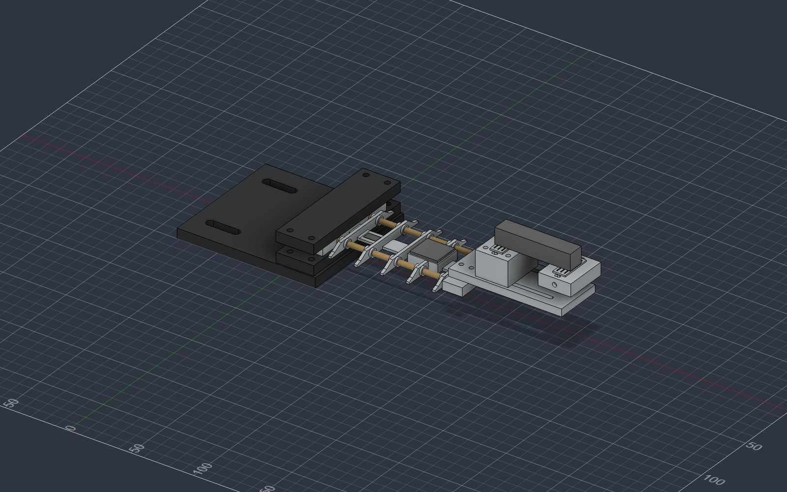
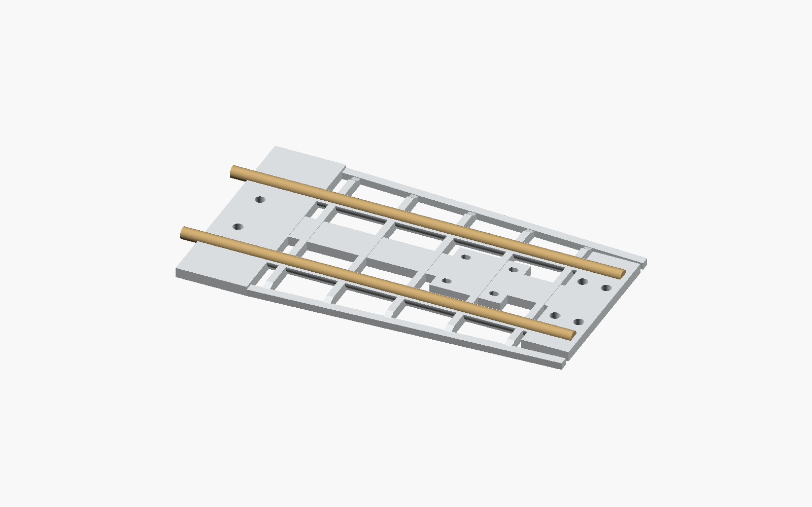

# SkySafe printable bench fixture — 140 mm printer / 4 mm bamboo

**Latest version: the user requested a 13–15 inch wing. Use [the 14.03-inch modular Fusion design](fusion_14inch/README.md) and its `fusion_14inch/stl/` files. The smaller wing described below is retained as a previous revision. Do not mix their wing sections.**

This CAD pass adds an open-rib wing, root clamp and hanging-load fixture to the completed software. **Every individual STL fits a 140 × 140 × 140 mm build volume.** The largest part is 128 mm long, leaving 6 mm at each end when centered on a 140 mm bed. All exports lie flat at Z = 0; print parts separately.

The wing is a tapered, flat-bottom, wing-shaped test specimen, not a validated aerodynamic airfoil. The loading hardware is a benchtop prototype with no verified load rating. A 5 kg sensor rating does not rate the printed wing or clamp. The user selected the 4.5 mm bore with a printed coupon; full assembly fit and structural performance have not been physically tested or analyzed.

**Fusion 360 is the primary CAD version.** Open `fusion/SkySafe_Assembly.f3d` with **File → Open → Open from my computer**. Use the seven files in `fusion/stl/` for printing. See [Fusion editing and exports](fusion/README.md). The earlier OpenSCAD files remain as an archived alternative; use one complete version consistently.



## Print these parts

| STL | Quantity | Bounding box, mm | Purpose |
| --- | ---: | --- | --- |
| `wing.stl` | 1 | 128 × 72 × 8 | Flexible wing, short bamboo guides, 1.8 mm gauge strip, MPU pad, tip landing |
| `root_base.stl` | 1 | 110 × 100 × 18 | Bench mounting plate, lower jaw and two alignment pins |
| `root_cap.stl` | 1 | 30 × 98 × 8 | Flat upper root jaw |
| `tip_adapter.stl` | 1 | 90 × 38 × 6 | Extended plate with two sliding pedestal rails |
| `cell_spacer.stl` | 1 | 26 × 34 × 21.2 | Tall fixed-end glue pedestal and rail bolt holes |
| `load_hanger.stl` | 1 | 26 × 34 × 11.2 | Free-end glue hanger with transverse cord hole |
| `spar_fit_coupon.stl` | 1 first | 24 × 60 × 8 | Checks real bamboo and horizontal printed hole clearance |

`fusion/SkySafe_Assembly.f3d` contains native sketches, feature history and seven printable components. The Fusion version raises the MPU pad to 7.2 mm so the board clears the ribs. Coupon numerals use engraved straight segments. The earlier `SkySafe.scad` includes assembled, exploded and spar-cutaway views; those previews show the earlier pad. Load-cell, board, gauge, cord and weight geometry in the assembly are **reference objects**, not printable parts. STL exports contain only the seven pieces above.

## Fit the 4 mm bamboo first

- There are **two aligned spanwise spar paths**, at Y = −18 and +18 mm, with five short guides per spar instead of continuous plastic tubes. Their center height is 3.4 mm above the wing bottom. The center strip connects the ribs into one printable piece; the old continuous edge rails are removed.
- The current Fusion modeled bore is **4.5 mm**, selected from the user's printed coupon: 4.0 mm bamboo plus 0.5 mm diametral clearance. Tube walls are nominally 1.15 mm. The channels enter through the root and stop at X = 126 mm, leaving a 2 mm solid tip end. The archived OpenSCAD version retains its earlier 4.4 mm bore.
- Print the coupon using the same orientation, material and settings as the wing. Its labels are the modeled bores: 4.1, 4.3, 4.4, 4.5 and 4.7 mm. Test the actual skewers along their full length; nominal 4 mm bamboo may vary or curve.
- Choose a snug, smooth sliding fit that does not require hammering or split the tubes. In Fusion, set the `sparClearance` user parameter to the chosen bore minus 4.0, then export the wing again in its original print orientation. Alternatively, change the builder default and rerun it. The earlier OpenSCAD parameter is `spar_clearance`. Do not scale the whole STL to change hole fit.
- Cut two straight skewers to **132 mm**, with square, smoothed ends: 126 mm engaged and 6 mm exposed at the back for withdrawal. Support the tip and gently feed each rod through the separated guides. Verify seating gently; never jam against the blind end.
- Leave the spars unglued for stiffness-comparison experiments. A removable tape keeper on the exposed ends can prevent drift. Check that the rods stay seated throughout every healthy run. Gluing is an alternative permanent build, but removes the reversible spars-out comparison.



## Glue-compatible load-cell mounting

The current Fusion version uses **two isolated, grooved 10 × 24 mm end pads** instead of a sensor-specific bolt pattern. Each pad has optional zip-tie slots. The fixed pedestal can slide on the tip adapter's rails; the loaded hanger remains attached only to the cell's other end. See [full glue-mount instructions](fusion/README.md#hot-glue-end-mount).

This accommodates differing screw patterns on **rectangular bar cells**. Check that each actual cell has a flat non-sensing end region large enough for the pad; keep adhesive and straps off the active middle, gauge cover and wire exit. Sensor shape still matters: disc, button, S-type and four-corner sensors require another mounting arrangement. The illustrated 60 × 12.7 × 12.7 mm bar is an example, not the cell you have purchased.

Glue only at the two end landings. Do not glue the middle or free hanger to the plate. The example has a 40 mm clear middle between the pads and 10 mm vertical clearance below the loaded hanger. Maintain that clearance under load. Let glue cool, check for slip and repeat readings at known loads before collecting a baseline. Glue strength and creep have not been validated.

Default carrier centers are X = 145 mm (fixed) and X = 195 mm (loaded). The root jaw ends at X = 24 mm, so the **force line has a 171 mm lever arm from the clamp exit**, even though the exposed printed wing is 104 mm long. Reposition the hanger to suit a different bar's end regions, and keep that geometry identical across recordings. Nominal 40–100 mm bar layouts are possible; confirm carrier separation and clearance for the actual cell.

The earlier OpenSCAD alternative and saved `SkySafe-Fusion360-bolt-mount.zip` retain the older screw-mounted design and 161 mm lever arm. Their mounting dimensions do not describe this revision. Use the current `fusion/stl/` files together.

## Hardware list

| Item | Quantity | Notes |
| --- | ---: | --- |
| 4 mm bamboo skewers | 2 | Cut to 132 mm after fit check |
| M4 × 35 mm machine bolts, nuts, washers | 4 each | Root clamp; check actual assembled grip and nut engagement |
| M3 × 16 mm bolts, nuts, washers | 4 each | Tip adapter; default stack is about 13 mm plus washer/nut |
| Hot glue | As needed | Sensor bonds only to the two grooved end pads |
| M3 × 35 mm bolts, nuts, washers | 4 each, optional | Locks the printed fixed pedestal to the rails; does not attach to sensor threads |
| Bench fasteners or external C-clamps | 2 | Base has two 6.6 mm wide, 20 mm travel slots |
| Thin cord, weight cup and small known masses | 1 set | Hanger cord hole is 3.5 mm; cup/cord are not included in CAD |
| Small cable ties and flexible wire | As needed | MPU board fastening and slack sensor leads |
| BF350-3AA and suitable bonding materials | 1 | Bond according to the gauge/adhesive instructions |

The optional pedestal bolts span about 26 mm of printed material plus washers/nut; check engagement. You can glue that pedestal-to-plate joint for a small prototype if those bolts are unavailable. No glue joint in this design has a validated load rating.

## Print and assemble

1. **Print and test the coupon.** Inspect the sliced channel roofs for bridging. Avoid support inside the spar bores; it would obstruct the rods. Choose a clearance from the coupon and regenerate if necessary.
2. Print the wing flat, with the root tongue, center strip and short-guide feet on the bed. Use the tested coupon's material and 0.2 mm layer height, with a 0.4 mm nozzle and 3 walls as a starting setup. 5–15% sparse infill can be used for the wing, but inspect the preview: guide walls must be continuous and the 1.8 mm center strip and narrow ribs must be filled with solid layers/perimeters. Use 5 top and 5 bottom layers at 0.2 mm so the thin strip is filled solid. Avoid support inside the guides. Keep material, walls, layer height and infill the same for comparisons. These are unvalidated print settings.
3. Print the clamp and load-fixture parts flat as supplied. The base has shallow bottom nut pockets: insert nuts before securing it to the bench. Remove burrs from bolt holes and check layer adhesion before assembly.
4. Insert the bamboo spars. Seat the wing root on the lower jaw: the two 3 mm pins enter the 3.4 mm holes at X = 8, Y = ±8. Fit the cap with four M4 bolts. Tighten evenly without crushing the root. The spar entry ports remain accessible from behind the root while clamped.
5. Secure the base to a rigid bench/board with two fasteners or C-clamps. Put the jaw at the bench edge so the wing, free cell end and hanging weights have clearance below. A loose fixture changes the measured response.
6. Attach the tip adapter with four M3 bolts. Locate the fixed glue pedestal on the rails and secure it with its four optional M3 bolts or a prototype glue bond. Hot-glue one non-sensing cell end to its raised landing and the other end to the free hanger landing. Use only enough glue to fill the shallow key grooves and make a thin bond at each end; keep the middle and wire exit clear. Optional ties go through each carrier's slots and around that same cell end. Keep the free hanger above the adapter with a visible air gap. Let glue cool, check attachment, and thread cord through the hanger hole for a small test cup. Tare/calibrate after assembly.
7. Bond the gauge **lengthwise along X** on the flat central strip around X = 33–43, Y = 0. The modeled reference backing is 10 × 6 mm; verify your gauge fits the available 16 × 12 mm flat region after the root shoulder and before the next rib. The strip is now 1.8 mm thick. Do not bond it to bamboo, a shoulder or a raised rib. Route slack leads through the open windows and strain-relieve them near the root.
8. Secure the MPU6050 carrier to the 24 × 22 mm flat pad at X = 74–98. The four small tie slots are generic, not an asserted GY-521 mounting pattern. Check your board and use an insulating mounting layer; ties must not touch components or obstruct the spars.

The archived exploded preview in `previews/exploded.png` shows the earlier bolt-mounted fixture; use the current Fusion assembly for this glue-mount revision.

## A physical comparison with the same gauge

First assemble with **both intact spars**, supporting the tip until they are seated. The sensors and mounting parts apply self-weight even with no added test mass. Check resting sag and attachment stability, then use small gradual loads and confirm the wing returns to its original resting position. Do not force it through a large hand bend or collect a baseline if it cracks, stays bent or slips. The thinner strip and separated guides are intended to increase flexibility, but self-weight support and the usable elastic range have not been physically verified.

If using the user's wood-and-C-clamp setup, `root_base.stl` is optional: firmly sandwich only the solid 24 mm root against a rigid board, using the root cap or a flat pressure-spreading block. Leave the wing, sensor, cord and hanger clear of the bench. Cardboard may be a thin protective pad, not the main fixture. The already-tested coupon does not need reprinting.

Use the same printed wing, gauge, clamp position, load-cell assembly and MPU attachment for both conditions. With both bamboo spars seated, zero/tare the unloaded assembled setup, calibrate force with known masses, and collect a healthy baseline over a mechanically acceptable measured load range. Keep cup/cord tare and excitation consistent.

Unload fully before withdrawing a spar. Remove one or both bamboo spars without unclamping the wing, moving the gauge or altering the tip fixture. Repeat the same loading and excitation. This creates a **controlled change in assembly stiffness**, not a calibrated damage percentage. Actual force/strain and vibration differences must be measured; the simulator's 80/124 counts/N slopes are not predictions for this CAD.

Keep the original baseline for the comparison. **ZERO and CALIBRATE invalidate it** in the software, so do not issue them between the two conditions. Removing bamboo also changes mass and unloaded strain offset; record that offset and account for it when interpreting the comparison. If withdrawal disturbs the fixture or the healthy return fails to reproduce, repeat setup and establish a fresh baseline. Do not bend, split or cut a loaded spar.

Begin with small incremental bench loads and inspect deflection, clamp slip, print separation and sensor attachment. Use a catch surface below the cup/wing. The software's simulated 1–13 N sweep and minimum 4 N baseline span are **software demo defaults, not permissible physical loads**. If the real specimen cannot accommodate that span, lower the baseline coverage requirement consistently in `dashboard/config.py` and firmware `Config.h`, document the narrower tested envelope, and retain the baseline quality checks. Tune tolerances only from repeatable measured healthy noise and controlled stiffness changes.

## Regenerate and verify

For the primary native model, follow [Fusion instructions](fusion/README.md). Its separate F3D files retain each part at Z = 0 for re-export after edits. To reproduce geometric mesh checks, run `cad/fusion/verify_meshes.py` with the dependencies below.

The commands below apply only to the earlier OpenSCAD alternative. Install [OpenSCAD](https://openscad.org/downloads.html), open `SkySafe.scad`, choose a part, render and export it. Official [OpenSCAD documentation](https://openscad.org/documentation.html) describes the modeling and export workflow. Or, from the project root:

```sh
python3 cad/export_cad.py
# Example: coupon selects 4.5 mm, so clearance = 0.5 mm
python3 cad/export_cad.py --spar-clearance 0.5
```

Set `SKYSAFE_OPENSCAD_BIN` if the executable is elsewhere. The exporter writes binary STL and per-part logs and stops on CAD warnings. Use a separate temporary environment for optional mesh checks:

```sh
python3 -m venv /tmp/skysafe-cad-check
/tmp/skysafe-cad-check/bin/python -m pip install trimesh numpy networkx
/tmp/skysafe-cad-check/bin/python cad/verify_meshes.py
```

The seven archived OpenSCAD parts passed watertightness, consistent winding, positive volume, one connected solid, Z = 0 and build-volume checks using OpenSCAD 2026.06.12 and trimesh 5.1.1. See `verification/mesh_report.json` and `verification/export_logs/`. Those are geometric checks only. Print fit, actual skewer/cell dimensions, mechanical strength, gauge sensitivity and safe loading remain bench measurements.

## Optional M3 laptop-foot stand

For the assembled 14-inch wing and a small raised clamp with a tab beneath a laptop, use [the one-print Fusion stand](fusion_laptop_stand/README.md). It replaces the old root base and reuses the existing cap. Print the supplied side-oriented STL. The [larger weighted holder](fusion_weighted/README.md) remains an alternative. Neither has a physically validated load rating.
